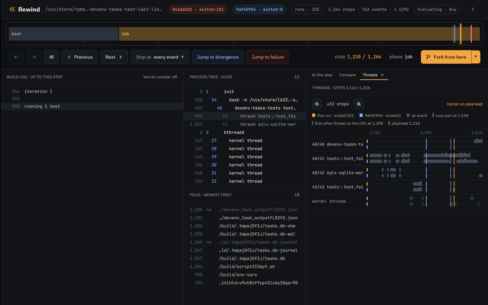

# Case study: lost task output in devenv

[devenv](https://devenv.sh/) could drop the last lines a task printed. This is
a known bug, reported in
[cachix/devenv#2281](https://github.com/cachix/devenv/issues/2281) and fixed
by the maintainer in [cachix/devenv#2296](https://github.com/cachix/devenv/pull/2296).
Rewind VM reproduced it, gdb in the VM shows `tokio::select!` taking the
child's exit with a line still buffered, and the fix passes every schedule.

Scrub the recording in your browser: [open it in the viewer](https://rewindvm.dev/viewer/?url=examples/devenv-task-output-race.rwd).

## The code

`devenv-tasks` runs each task as a child process and reads its output a line
at a time in one `tokio::select!` loop
([task_state.rs at 1.10.1](https://github.com/cachix/devenv/blob/cecb0452cacd9c524ccfc973d5caffff834cbf02/devenv-tasks/src/task_state.rs#L365-L431)):

```rust {18}
        loop {
            tokio::select! {
                result = stdout_reader.next_line(), if !stdout_closed => {
                    match result {
                        Ok(Some(line)) => {
                            ...
                            stdout_lines.push((std::time::Instant::now(), line));
                        },
                        Ok(None) => {
                            stdout_closed = true;
                        },
                        ...
                    }
                }
                result = stderr_reader.next_line(), if !stderr_closed => {
                    ...
                }
                result = child.wait() => {
                    match result {
                        Ok(status) => {
                            ...
                            if status.success() {
                                return Ok(TaskCompleted::Success(now.elapsed(), Self::get_outputs(&outputs_file).await));
                            } else {
                                return Ok(TaskCompleted::Failed(
                                    now.elapsed(),
                                    TaskFailure {
                                        stdout: stdout_lines,
                                        stderr: stderr_lines,
                                        error: format!("Task exited with status: {status}"),
                                    },
                                ));
                            }
                        },
```

When the `child.wait()` branch runs, the function returns with the lines it
has so far.

## The test

The derivation adds one test to `devenv-tasks`' unit tests and runs only that
test ([flake](../../examples/case-studies/flake.nix)):

```rust
#[tokio::test]
async fn test_failed_task_keeps_last_lines() -> Result<(), Error> {
    let temp_dir = TempDir::new().unwrap();
    let db_path = temp_dir.path().join("tasks.db");
    let script = create_script("#!/bin/sh\necho line1\necho line2\necho line3\nexit 1\n")?;
    let tasks = Tasks::builder(
        Config::try_from(json!({
            "roots": ["myapp:task_1"],
            "run_mode": "all",
            "tasks": [{ "name": "myapp:task_1", "command": script.to_str().unwrap() }]
        }))
        .unwrap(),
        VerbosityLevel::Verbose,
        Shutdown::new(),
    )
    .with_db_path(db_path)
    .build()
    .await?;
    tasks.run().await;
    match inspect_tasks(&tasks).await.as_slice() {
        [(_, TaskStatus::Completed(TaskCompleted::Failed(_, failure)))] => {
            let lines: Vec<&str> = failure.stdout.iter().map(|(_, l)| l.as_str()).collect();
            assert_eq!(lines, vec!["line1", "line2", "line3"]);
        }
        other => panic!("unexpected task statuses: {other:?}"),
    }
    Ok(())
}
```

## Run it

`tokio::select!` takes its branch order from the VM's randomness, which
`--seed` sets. Seed 5 fails on the first run:

```console
$ rewind nix --seed 5 'github:fzakaria/rewindvm?dir=examples/case-studies#devenv-last-lines-before-2296'
rewind: packing 57 store paths for devenv-tasks-test-last-lines-before-2296
iteration 1

running 1 test
test tests::test_failed_task_keeps_last_lines ... FAILED

failures:

---- tests::test_failed_task_keeps_last_lines stdout ----
[myapp:task_1] line1
[myapp:task_1] line2

thread 'tests::test_failed_task_keeps_last_lines' (41) panicked at devenv-tasks/src/tests/mod.rs:3006:13:
assertion `left == right` failed
  left: ["line1", "line2"]
 right: ["line1", "line2", "line3"]
...
rewind: run 6544e96a1f5fd1a9 exited:101 after 1241 steps, 0.034s virtual, 0.342s wall (poweroff)

$ rewind replay 6544e96a
identical to the recording: 772 events over 1241 steps
```

The task printed three lines and devenv kept two, as in the issue.

## How often it fails

```console
$ rewind check --seed 5 --all --schedules 256 'github:fzakaria/rewindvm?dir=examples/case-studies#devenv-last-lines-before-2296'
schedule   0: exited:101       1241 steps    run 6544e96a1f5fd1a9
schedule   1: exited:101       1288 steps    run ecb95645a75de3c2
schedule   2: exited:0       1382 steps  77ac62e2629d  run 7e4a37b7d471985f
schedule   3: exited:101       1338 steps    run c7068d6c5f13a7dd
...
schedule 256: exited:101       1352 steps    run 5de3158c1d4279c3
schedule 0 failed; 39 of 256 other schedules ended differently

schedule 2 passes where schedule 0 fails; finding the step that decides it
schedule 2 limited to steps 1132..1187 still ends differently
step 1186 decides it: a request to switch threads there makes the run pass

passing: run 6cae788ea403bb7d, schedule 2 over steps 1132..1187
failing: run a5e20f49f3dcee36, schedule 2 over steps 1132..1186
the two are the same run until step 1186

where /nix/store/195dbbvj5h0yq9f4vnp833dsbgxpp8w0-devenv-tasks-tests-1.10.1/bin/devenv-tasks-tests test_failed_task_keeps_last_lines first behaves differently:
  both           1217    40/41    unlink("/build/.tmpGDEDU5/tasks.db")
  both           1218    40/41    unlink("/build/.tmpGDEDU5")
  both           1220    40/41    thread exit(tests::test_fai) exited:0
  failing        1224    40/40    write(1, "FAILED")
  failing        1225    40/40    write(1, "\n")
  failing        1227    40/40    write(1, "\nfailures:\n")
  failing        1228    40/40    write(1, "\n")
  passing        1236    40/40    write(1, "ok")
  passing        1237    40/40    write(1, "\n")
  passing        1239    40/40    write(1, "\n")
  passing        1240    40/40    write(1, "test result: ")

open both in the desktop app: rewind open a5e20f49f3dcee36 1224 --compare 6cae788ea403bb7d
```

218 of 257 runs fail, 215 of them with `["line1", "line2"]` and 3 with
`["line1"]`. The two runs of the narrowed pair make the same calls, so the
diff shows only the test's result. What differs is when the task's shell gets
the CPU.

## Who had the CPU

`rewind threads` prints which thread held the CPU through each stretch of
steps, here for the failing run and then the passing one:

```console
$ rewind threads a5e20f49f3dcee36 --from 1170 --to 1210
      1170       1171         40/41  tests::test_fai
      1172       1172     kernel 11  ksoftirqd/0
      1173       1174         40/41  tests::test_fai
      1175       1175         43/43  scriptfRH5PT.sh
      1176       1176     kernel 11  ksoftirqd/0
      1177       1179         40/41  tests::test_fai
      1180       1181     kernel 11  ksoftirqd/0
      1182       1187         43/43  scriptfRH5PT.sh
      1188       1188     kernel 11  ksoftirqd/0
      1189       1204         40/41  tests::test_fai
      1205       1205     kernel 11  ksoftirqd/0
      1206       1209         40/42  sqlx-sqlite-wor
      1210       1210     kernel 11  ksoftirqd/0

$ rewind threads 6cae788ea403bb7d --from 1170 --to 1210
      1170       1171         40/41  tests::test_fai
      1172       1172     kernel 11  ksoftirqd/0
      1173       1174         40/41  tests::test_fai
      1175       1175         43/43  scriptfRH5PT.sh
      1176       1176     kernel 11  ksoftirqd/0
      1177       1179         40/41  tests::test_fai
      1180       1181     kernel 11  ksoftirqd/0
      1182       1187         43/43  scriptfRH5PT.sh
      1188       1188     kernel 11  ksoftirqd/0
      1189       1202         40/41  tests::test_fai
      1203       1203         43/43  scriptfRH5PT.sh
      1204       1204     kernel 11  ksoftirqd/0
      1205       1210         40/41  tests::test_fai
```

In the failing run the shell (43) finishes exiting before thread 41 runs. In
the passing run the reschedule at step 1186 sends the shell off the CPU before
its exit is done, and it finishes only at 1203. The app's Threads tab shows
the same:



Perturbing only from step 1163, where the run forks the task's shell, gives
about the same pass rate, so the outcome is decided after the task starts:

```console
$ rewind check --run 6544e96a --schedule-from 1163 --schedules 64 --all --no-narrow
schedule   0: exited:101       1241 steps    run 6544e96a1f5fd1a9
schedule   1: exited:101       1255 steps    run c3335161d19a3e8d
schedule   2: exited:101       1283 steps    run 70026aba5943a7b5
schedule   3: exited:101       1267 steps    run c480b419033090dd
...
schedule  64: exited:101       1256 steps    run 2db3efabd1dea387
run 6544e96a1f5fd1a9 failed; 9 of 64 other schedules ended differently
```

## Where the third line went

The events of schedule 0's run around the task:

```console
$ rewind events 6544e96a --from 1155 --to 1175
      1160    40/41    open("/build/devenv_task_outputsohcU0.json", 0o2000302)
      1163    40/41    fork() = 43
      1167    43/43    execve("/build/scriptfRH5PT.sh", ["/bin/sh", "/build/scriptfRH5PT.sh"])
      1168    43/43    exit_group(scriptfRH5PT.sh) exited:1
      1171    40/41    SIGCHLD code=1 addr=0x0
```

The shell prints all three lines and exits before the loop reads anything.
`rewind gdb` opens gdb on a fork of the run at a step. Break on `read` of the
stdout pipe (fd 13) and on the `child.wait()` branch:

```console
$ rewind gdb 6544e96a 1160 -- -batch -ex 'break read if $rdi == 13' -ex 'break task_state.rs:409' -ex continue -ex 'set $buf = $rsi' -ex finish -ex 'x/s $buf' -ex 'delete 1' -ex continue
rewind: step 1160 ran in process 40; loading symbols for 5 of its files
rewind: source files for /nix/store/195dbbvj5h0yq9f4vnp833dsbgxpp8w0-devenv-tasks-tests-1.10.1 from /nix/store/hs2328bm8f7s0cq77jjjgdlcqrc13mhm-source
rewind: gdb at step 1160 of 6544e96a1f5fd1a9
arch_local_irq_restore (flags=514) at ./arch/x86/include/asm/irqflags.h:146
146		return !(flags & X86_EFLAGS_IF);
[Switching to thread 3 (Thread 1.41)]
#0  __syscall_cancel_arch () at ../sysdeps/unix/sysv/linux/x86_64/syscall_cancel.S:56
56		ret
Breakpoint 1 at 0x7ff64601f190: file ../sysdeps/unix/sysv/linux/read.c, line 25.
Breakpoint 2 at 0x55dd6284c8a7: task_state.rs:409. (2 locations)

Thread 3 hit Breakpoint 1, __GI___libc_read (fd=13, buf=0x7ff640015f20, nbytes=8192) at ../sysdeps/unix/sysv/linux/read.c:25
25	{
0x000055dd62b239bd in std::fs::{impl#9}::read (buf=Python Exception <class 'gdb.error'>: value has been optimized out
&mut [u8](size=8192), self=<optimized out>) at /rustc/48a229ceaefd4985c50990b14116b6d856af0985/library/std/src/fs.rs:1335
warning: 1335	/rustc/48a229ceaefd4985c50990b14116b6d856af0985/library/std/src/fs.rs: No such file or directory
Value returned is $1 = 18
0x7ff640015f20:	"line1\nline2\nline3\n"

Thread 3 hit Breakpoint 2.1, devenv_tasks::task_state::{impl#1}::run::{async_fn#0}::{async_block#0}::{async_block#0} () at devenv-tasks/src/task_state.rs:415
415	                            let expanded_paths = expand_glob_patterns(&self.task.exec_if_modified);
[Inferior 1 (process 1) detached]
```

One read returns all three lines into the `BufReader`. The loop takes two of
them, then takes the `child.wait()` branch with `line3` still buffered, and
returns.

## Root cause

Without `biased;`, `tokio::select!` polls its branches in a random order on
each pass. Once the child has exited, `child.wait()` is ready on every pass,
and so is each buffered line. Each pass is a draw between "take the next line"
and "return now", and any line still buffered when `child.wait()` wins is
lost.

The window opens when the exit is visible before the output is read. On one
CPU the shell often runs from `execve` to `exit` without giving up the CPU, so
the output and the exit are waiting together when the loop starts.

## The fix, checked

The fix
([de0dc6a8](https://github.com/cachix/devenv/commit/de0dc6a85ae88eb8194c2f7e053f3e933b77c2ac))
stores the exit status, turns the `child.wait()` branch off, and keeps
reading until both pipes are closed:

```diff
         loop {
+            // If child has exited and both pipes are closed, we're done
+            if exit_status.is_some() && stdout_closed && stderr_closed {
+                break;
+            }
+
             tokio::select! {
...
-                result = child.wait() => {
+                result = child.wait(), if exit_status.is_none() => {
...
-                            if status.success() {
-                                return Ok(TaskCompleted::Success(now.elapsed(), Self::get_outputs(&outputs_file).await));
-                            } else {
-                                ...
-                            }
+                            // Store exit status and continue draining pipes
+                            exit_status = Some(status);
```

The same test at the merge commit passes every schedule:

```console
$ rewind check --seed 5 --all --schedules 256 'github:fzakaria/rewindvm?dir=examples/case-studies#devenv-last-lines-2296'
rewind: packing 57 store paths for devenv-tasks-test-last-lines-2296
schedule   0: exited:0       1265 steps  77ac62e2629d  run 3a63d6f3fb4609e6
schedule   1: exited:0       1328 steps  77ac62e2629d  run f4e0ee9226d42c85
schedule   2: exited:0       1382 steps  77ac62e2629d  run 8c0642d5e58dd52d
...
0 of 256 other schedules ended differently
same result under all 257 schedules
```

On the host the unfixed test passed 1000 of 1000 runs on 16 CPUs, and 1000 of
1000 pinned to one CPU.

## The recording

Both files are in the
[case-studies release](https://github.com/fzakaria/rewindvm/releases/tag/case-studies):

- [devenv-task-output-race.rwd](https://github.com/fzakaria/rewindvm/releases/download/case-studies/devenv-task-output-race.rwd)
  (10.1 KB), the trace, for `rewind events`, `rewind log` and the app; the
  [viewer](https://rewindvm.dev/viewer/?url=examples/devenv-task-output-race.rwd) opens it in a browser.
- [devenv-task-output-race-replayable.rwd](https://github.com/fzakaria/rewindvm/releases/download/case-studies/devenv-task-output-race-replayable.rwd)
  (185.1 MB), with the kernel, input image and keyframes, for `rewind replay`,
  `rewind gdb` and `rewind shell`.

```console
$ rewind import https://github.com/fzakaria/rewindvm/releases/download/case-studies/devenv-task-output-race-replayable.rwd
$ rewind replay 6544e96a
$ rewind gdb 6544e96a 1160
$ rewind-app https://github.com/fzakaria/rewindvm/releases/download/case-studies/devenv-task-output-race.rwd
```
