# Tutorial: advanced features

Short recipes for what the [Nix](tutorial-nix.md) and
[container](tutorial-container.md) tutorials leave out, each in the terminal
and in the desktop app. They use the Nix tutorial's runs and install.

## The runs

```console
$ rewind check --epoch 1790985600 github:fzakaria/rewindvm#mylib | grep -E 'ends differently|perturbing only|decides it|passing:|failing:|same run until|open both'
rewind: packing 62 store paths for mylib-0.3.0
schedule 3 ends differently; narrowing the steps it perturbs
perturbing only steps 4821..5081 still ends differently
step 5080 decides it: a 1280 µs stall there makes the run fail
passing: run 516c10eebf667023, schedule 3 over steps 4821..5080
failing: run c2ca1ecd2243eff6, schedule 3 over steps 4821..5081
the two are the same run until step 5080
open both in the desktop app: rewind open c2ca1ecd2243eff6 5105 --compare 516c10eebf667023
```

The failing run crashes at step 5105.

## Find the line a thread was on

`rewind where` names the line of the program's own code a thread was on at a
step, skipping the C library and, in Rust, the standard library and
dependencies. By default it picks the thread of the step's event; at 5105
that is the worker that segfaulted:

```console
$ rewind where c2ca1ecd 5105
rewind: process 166 at step 5105; loading symbols for 4 of its files
rewind: fetched 3 source files from the VM
rewind: walking thread 174's stack in gdb
rewind: downloading debug info for libc.so.6; first time only
rewind: downloading debug info for libpthread.so.0; first time only
rewind: downloading debug info for ld-linux-x86-64.so.2; first time only
rewind: downloading the sources of libc.so.6; first time only
process 166 (test_pool_shutdown), thread 174, at step 5105
#0 worker (src/pool.c:77)
      75  			printf("job %d done: %ld\n", job, result & 0xffff);
      76  			fflush(stdout);
>     77  			p->queue->completed++;
      78  		}
      79  	}
called from #1 start_thread (pthread_create.c:454)
called from #2 __GI___clone3 (../sysdeps/unix/sysv/linux/x86_64/clone3.S:78)
```

`--tid` picks another thread, on the CPU or not. At step 5105, where
the worker faults, the main thread is waiting to join the workers:

```console
$ rewind where c2ca1ecd 5105 --tid 166
rewind: process 166 at step 5105; loading symbols for 4 of its files
rewind: read 3 source files fetched from the VM earlier
rewind: walking thread 166's stack in gdb
rewind: downloading the sources of libc.so.6; first time only
process 166 (test_pool_shutdown), thread 166, at step 5105
#7 pool_shutdown (src/pool.c:128)
     126
     127  	for (int i = 0; i < POOL_WORKERS; i++)
>    128  		pthread_join(p->workers[i], NULL);
     129  	pthread_cond_destroy(&p->ready);
     130  	pthread_mutex_destroy(&p->lock);
called from #8 main (tests/test_pool_shutdown.c:24)
called from #9 __libc_start_call_main (../sysdeps/nptl/libc_start_call_main.h:59)
```

`--json` prints every frame and which one was chosen. For every frame of
every thread, ask gdb for all the stacks of the process:

```console
$ rewind gdb c2ca1ecd 5105 --pid 166 -- -batch -ex 'thread apply all bt' 2>/dev/null | grep -E '^Thread|src/|tests/'
#0  0x00005556d620d437 in worker (arg=0x5556f833c010) at src/pool.c:77
Thread 4 (Thread 1.174 (test_pool_shutd, on the CPU)):
#0  0x00005556d620d437 in worker (arg=0x5556f833c010) at src/pool.c:77
Thread 3 (Thread 1.173 (test_pool_shutd)):
#5  worker (arg=0x5556f833c010) at src/pool.c:75
Thread 2 (Thread 1.166 (test_pool_shutd)):
#7  0x00005556d620d5b3 in pool_shutdown (p=p@entry=0x5556f833c010) at src/pool.c:128
#8  0x00005556d620d272 in main () at tests/test_pool_shutdown.c:24
Thread 1 (Thread 1.4194305 (the CPU, in test_pool_shutd 174)):
```

`rewind gdb` starts in the thread `rewind where` looks at, in its innermost
frame. `--tid` and `--frame` start it elsewhere, with frames numbered as
`where --json` numbers them. In the main thread's frame that `where` chose,
`pool_shutdown` has already set the queue to NULL:

```console
$ rewind gdb c2ca1ecd 5105 --tid 166 --frame 7 -- -batch -ex 'p p->queue'
rewind: process 166 at step 5105; loading symbols for 4 of its files
rewind: read 3 source files fetched from the VM earlier
rewind: gdb at step 5105 of c2ca1ecd2243eff6
0xffffffff81286b1c in __outl (value=<optimized out>, port=1504) at ./arch/x86/include/asm/shared/io.h:24
24	BUILDIO(l,  , u32)
[Switching to thread 2 (Thread 1.166)]
#0  __syscall_cancel_arch () at ../sysdeps/unix/sysv/linux/x86_64/syscall_cancel.S:56
56		ret
#7  0x00005556d620d5b3 in pool_shutdown (p=p@entry=0x5556f833c010) at src/pool.c:128
128			pthread_join(p->workers[i], NULL);
$1 = (struct queue *) 0x0
[Inferior 1 (process 1) detached]
```

`where` and gdb read each thread's registers from the VM kernel's task list,
so they work on runs recorded with a guest that lists its tasks, as these
were.

In the app, the s key opens the source panel at the line `rewind where` names,
with the thread's frames below it; click a frame to see its line instead. The
panel follows the playhead, and each new step takes a few seconds since it
forks the run.

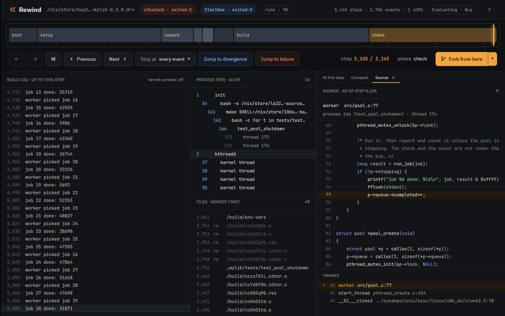

## Find the step that decides it

`check` names step 5080 as the one that decides it. Its passing run is the
same schedule without that step, so the two runs are the same machine until
5080, where only the failing run gets a 1280 µs stall, and everything
they do differently follows from it. `rewind where` names the thread that was
on the CPU there:

```console
$ rewind where c2ca1ecd 5080
rewind: process 166 at step 5080; loading symbols for 4 of its files
rewind: read 3 source files fetched from the VM earlier
rewind: walking thread 174's stack in gdb
rewind: downloading the sources of libc.so.6; first time only
process 166 (test_pool_shutdown), thread 174, at step 5080
#14 worker (src/pool.c:75)
      73  		long result = run_job(job);
      74  		if (!p->stopping) {
>     75  			printf("job %d done: %ld\n", job, result & 0xffff);
      76  			fflush(stdout);
      77  			p->queue->completed++;
called from #15 start_thread (pthread_create.c:454)
called from #16 __GI___clone3 (../sysdeps/unix/sysv/linux/x86_64/clone3.S:78)
```

A worker checks `p->stopping` without the lock, prints its job, and then
counts it through `p->queue`, which `pool_shutdown` frees. At step
5080 the worker has made its check and is printing; a 1280 µs stall
there holds it before the count. The test's main thread runs meanwhile, sees
half the jobs done, and shuts the pool down, setting the queue to NULL, and
the worker faults on it 25 steps later. Without that step's
perturbation, the worker counts first and the test passes.

`check --where` looks up both threads itself: the one on the CPU at the
deciding step, and the one at the failing run's first differing event. Each
lookup forks the run and starts gdb, so it is opt-in:

```console
$ rewind check --where --epoch 1790985600 github:fzakaria/rewindvm#mylib 2>/dev/null | sed -n '/^where the threads were/,/first event that differs$/p'
where the threads were:
        5080   166/174   worker (src/pool.c:75), on the CPU at the deciding step
        5105   166/174   worker (src/pool.c:77), at the first event that differs
```

In the app, the deciding step is a dashed blue mark on the timeline, before
the solid one where the runs' events first differ. Zoomed in around the crash:

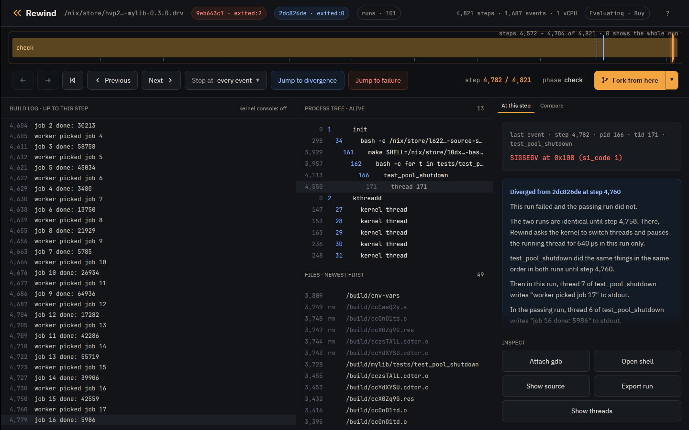

## See which thread held the CPU

The VM has one CPU, so a race is an order of threads. `rewind threads` replays
a window of steps and prints which thread held the CPU, a line per stretch.
Around the deciding step, in both runs:

```console
$ rewind threads c2ca1ecd --from 5071 --to 5105
      5071       5071       166/174  test_pool_shutd
      5072       5078          idle  swapper/0
      5079       5081       166/174  test_pool_shutd
      5082       5086       166/173  test_pool_shutd
      5087       5087       166/166  test_pool_shutd
      5088       5099          idle  swapper/0
      5100       5105       166/174  test_pool_shutd
```

```console
$ rewind threads 516c10ee --from 5071 --to 5105
      5071       5071       166/174  test_pool_shutd
      5072       5078          idle  swapper/0
      5079       5086       166/174  test_pool_shutd
      5087       5090       166/173  test_pool_shutd
      5091       5091       166/166  test_pool_shutd
      5092       5097          idle  swapper/0
      5098       5099       166/174  test_pool_shutd
      5100       5100    kernel 174  test_pool_shutd
      5101       5105          idle  swapper/0
```

The lines match up to step 5080. From there the threads take the CPU in
another order, and in the failing run thread 174 holds it at the crash.
A thread that took the CPU and gave it back between two exits is not seen.

In the app, the t key opens the Threads tab: a lane per thread around where
the two runs part, this run's above the compared run's, with a bar wherever
the thread held the CPU. Ctrl and the wheel zoom the lanes and Shift and the
wheel pan them. Clicking a bar moves the playhead there:

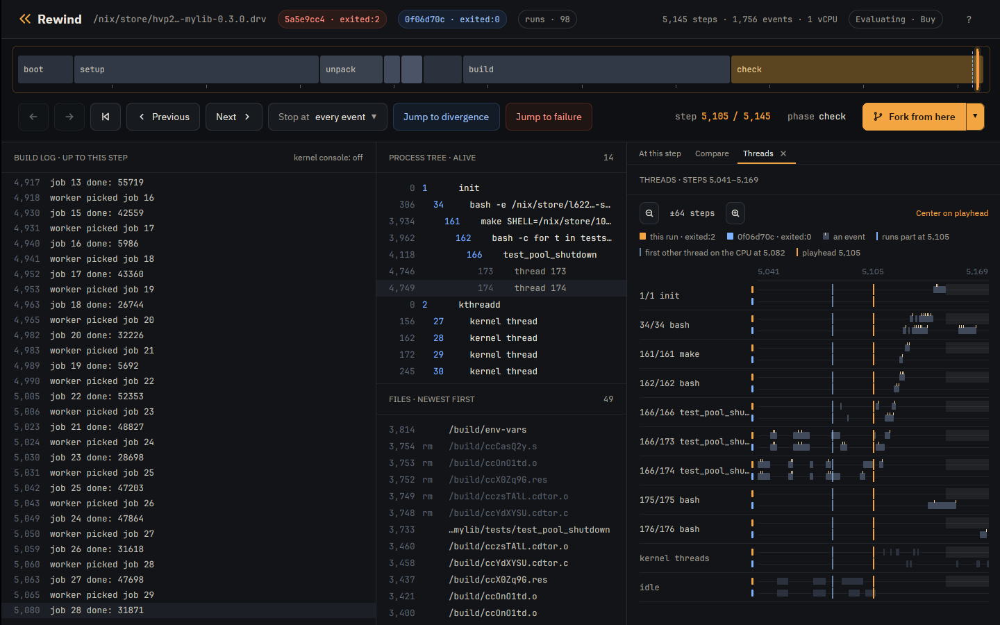

## Watch both sides of the race

A watchpoint finds who freed the queue the crash reads. Break in a worker so
`p` is in scope, watch `p->queue`, and continue:

```console
$ rewind gdb c2ca1ecd 5059 -- -batch -ex 'break src/pool.c:74' -ex continue -ex 'watch -l p->queue' -ex 'delete 1' -ex continue -ex 'bt 2' -ex 'break src/pool.c:77 if p->queue == 0' -ex continue -ex 'bt 1'
rewind: step 5059 ran in process 166; loading symbols for 4 of its files
rewind: read 3 source files fetched from the VM earlier
rewind: gdb at step 5059 of c2ca1ecd2243eff6
0xffffffff812868ab in __outl (value=<optimized out>, port=1504) at ./arch/x86/include/asm/shared/io.h:24
24	BUILDIO(l,  , u32)
[Switching to thread 4 (Thread 1.174)]
#0  __syscall_cancel_arch () at ../sysdeps/unix/sysv/linux/x86_64/syscall_cancel.S:56
56		ret
Breakpoint 1 at 0x5556d620d3a9: file src/pool.c, line 74.
[Switching to Thread 1.173]

Thread 3 hit Breakpoint 1, worker (arg=0x5556f833c010) at src/pool.c:74
74			if (!p->stopping) {
Hardware watchpoint 2: -location p->queue
[Switching to Thread 1.166]

Thread 2 hit Hardware watchpoint 2: -location p->queue

Old value = (struct queue *) 0x5556f833c090
New value = (struct queue *) 0x0
pool_shutdown (p=p@entry=0x5556f833c010) at src/pool.c:128
128			pthread_join(p->workers[i], NULL);
#0  pool_shutdown (p=p@entry=0x5556f833c010) at src/pool.c:128
#1  0x00005556d620d272 in main () at tests/test_pool_shutdown.c:24
Breakpoint 3 at 0x5556d620d433: file src/pool.c, line 77.
[Switching to Thread 1.174]

Thread 4 hit Breakpoint 3, worker (arg=0x5556f833c010) at src/pool.c:77
77				p->queue->completed++;
#0  worker (arg=0x5556f833c010) at src/pool.c:77
[Inferior 1 (process 1) detached]
```

The first stop is `main` nulling the queue in `pool_shutdown`, the second the
worker reading it. Watchpoints are the CPU's four debug registers, so the VM
runs at full speed until one fires. `watch` and `awatch` work; x86 has no
`rwatch`. At user addresses they stop only in the process gdb started in.

In the app, Attach gdb opens the same session under the timeline:

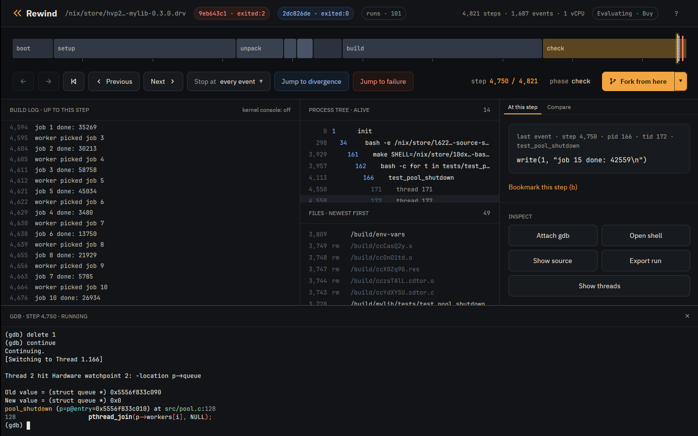

## Follow the fault into the kernel

`rewind gdb` has the VM kernel's symbols too. Stop where the kernel sends the
SIGSEGV, and use its own gdb scripts:

```console
$ rewind gdb c2ca1ecd 5080 -- -batch -ex 'break force_sig_fault' -ex continue -ex 'bt 4' -ex 'pipe lx-ps | tail -4' -ex 'pipe lx-dmesg | tail -2'
rewind: step 5080 ran in process 166; loading symbols for 4 of its files
rewind: read 3 source files fetched from the VM earlier
rewind: gdb at step 5080 of c2ca1ecd2243eff6
0xffffffff812868ab in __outl (value=<optimized out>, port=1504) at ./arch/x86/include/asm/shared/io.h:24
24	BUILDIO(l,  , u32)
[Switching to thread 4 (Thread 1.174)]
#0  __syscall_cancel_arch () at ../sysdeps/unix/sysv/linux/x86_64/syscall_cancel.S:56
56		ret
Downloading 133.41 K source file /build/linux-7.2.8/kernel/signal.c...
Breakpoint 1 at 0xffffffff812c3cf0: file kernel/signal.c, line 1757.
[Switching to Thread 1.4194305]

Thread 1 hit Breakpoint 1, force_sig_fault (sig=11, code=1, addr=0x108) at kernel/signal.c:1757
1757	{
#0  force_sig_fault (sig=11, code=1, addr=0x108) at kernel/signal.c:1757
#1  0xffffffff81e70910 in handle_page_fault (regs=0xffffc900001dbf58, error_code=6, address=264) at arch/x86/mm/fault.c:1483
#2  exc_page_fault (regs=0xffffc900001dbf58, error_code=6) at arch/x86/mm/fault.c:1536
#3  0xffffffff810012a6 in asm_exc_page_fault () at ./arch/x86/include/asm/idtentry.h:595
0xffff888003810fc0  162  bash
0xffff888003810000  166  test_pool_shutd
0xffff888003bbde80  173  test_pool_shutd
0xffff888003bbcec0  174  test_pool_shutd
[    0.202888] test_pool_shutd[174]: segfault at 108 ip 00005556d620d437 sp 00007feee6e68e10 error 6 in test_pool_shutdown[1437,5556d620d000+1000] likely on CPU 0 (core 0, socket 0)
[    0.202893] Code: fa 48 8d 35 2a 0c 00 00 bf 02 00 00 00 b8 00 00 00 00 e8 ac fc ff ff 48 8b 05 b5 2b 00 00 48 8b 38 e8 8d fc ff ff 49 8b 46 58 <83> 80 08 01 00 00 01 e9 b5 fe ff ff 55 48 89 e5 41 54 53 be 78 00
[Inferior 1 (process 1) detached]
```

The kernel's DWARF comes from `rewindvm.cachix.org` with Nix, and from the
debug tarball next to `rewind` without. The app's build log shows the kernel's
messages beside the program's with kernel console on:

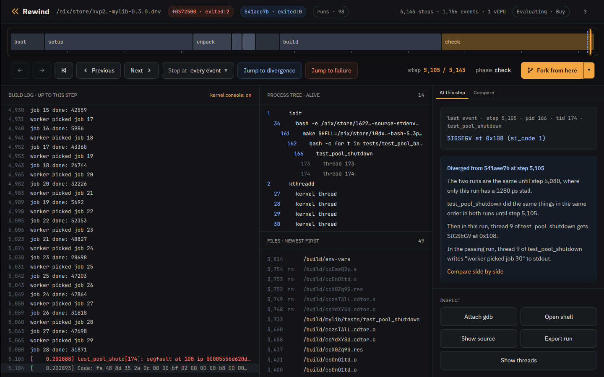

## Use your own gdb

`--listen` serves the fork for a gdb started elsewhere, such as an IDE's, and
prints the command line that loads the same symbols:

```console
$ rewind gdb c2ca1ecd 5105 --listen 127.0.0.1:1234
rewind: step 5105 ran in process 166; loading symbols for 4 of its files
rewind: read 3 source files fetched from the VM earlier
rewind: gdb at step 5105 of c2ca1ecd2243eff6; connect with: gdb -q -iex 'add-auto-load-safe-path /nix/store/h4wfwic161kxrr74jlzla5lsm28hgary-glibc-2.44-25' -iex 'set debuginfod enabled on' -iex 'set debuginfod urls http://127.0.0. ...
```

## Bring tools into the VM

`rewind shell --with` adds a Nix package to the shell, without changing the
run. Here binutils disassembles the faulting instruction:

```console
$ printf 'objdump -d --no-show-raw-insn --start-address=0x142c --stop-address=0x143e tests/test_pool_shutdown | tail -4; exit\n' | rewind shell c2ca1ecd 5105 --pid 166 --with nixpkgs#binutils
rewind: packing 21 store paths for --with
rewind: a shell at step 5105 of c2ca1ecd2243eff6; exit it to leave
[rewind] /build/mylib # objdump -d --no-show-raw-insn --start-address=0x142c --stop-address=0x143e tests/test_pool_shutdown | tail -4; exit
    142c:	mov    (%rax),%edi
    142e:	call   10c0 <fflush@plt>
    1433:	mov    0x58(%r14),%rax
    1437:	addl   $0x1,0x108(%rax)
```

In the app, Open shell starts a shell at the playhead in the terminal pane,
in the crashing process's working directory:

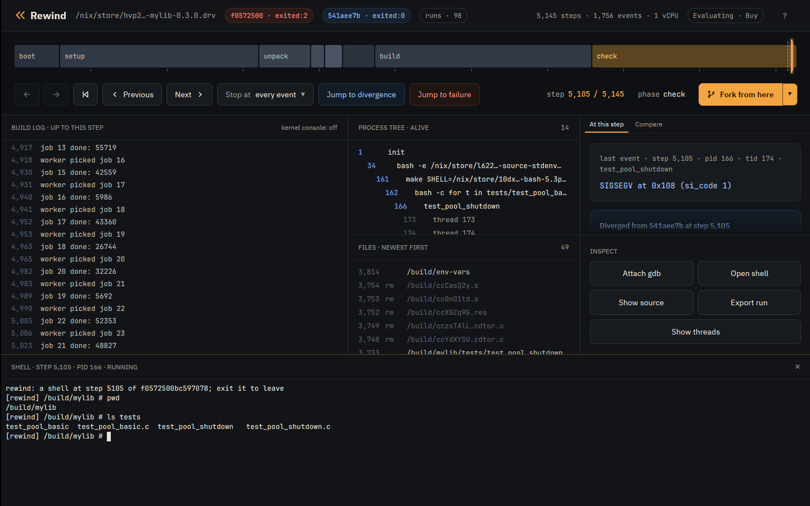

## Give programs more CPUs

The VM has one vCPU, so by default programs see one CPU and Nix builds run
one job at a time. `--cores` tells them there are more, and the extra threads
interleave on the one vCPU:

```console
$ rewind nix --cores 4 --epoch 1790985600 github:fzakaria/rewindvm#mylib
...
rewind: run 5e1803777866a78b exited:0 after 6209 steps, 0.217s virtual, 3.134s wall (poweroff)
/nix/store/f6a9gy362szw6nxx3ikrklr8glr6rdln-mylib-0.3.0 a9d703ba89774f3d  matches your store, rewindvm.cachix.org
```

```console
$ printf 'nproc; echo $NIX_BUILD_CORES; exit\n' | rewind shell 5e180377 2486 --pid 110
rewind: a shell at step 2486 of 5e1803777866a78b; exit it to leave
[rewind] /build/mylib # nproc; echo $NIX_BUILD_CORES; exit
4
4
```

Go programs see the extra CPUs too, and Go's garbage collector can then
spin waiting for a thread that never runs. Run them with `GOGC=off` if they
fit in the VM's memory.

## Steer the perturbation

`check --schedules N` tries more or fewer schedules, `--all` all of them.
`rewind fork` asks which schedules fail from a given step:

```console
$ rewind fork c2ca1ecd 5005 --schedule 1 --quiet
rewind: run db259d548c9a8e5f exited:2 after 5164 steps, 0.202s virtual, 0.392s wall (poweroff)
rewind: the fork first differs from its parent at step 5026
rewind: open it beside its parent in the desktop app: rewind open db259d548c9a8e5f 5026 --compare c2ca1ecd2243eff6

$ rewind fork c2ca1ecd 5005 --schedule 2 --quiet
rewind: run d5fb1b2ea1be0a74 exited:0 after 6560 steps, 0.221s virtual, 0.458s wall (poweroff)
rewind: the fork first differs from its parent at step 5024
rewind: open it beside its parent in the desktop app: rewind open d5fb1b2ea1be0a74 5024 --compare c2ca1ecd2243eff6

$ rewind fork c2ca1ecd 5005 --schedule 3 --quiet
rewind: run e683d3ea860e70bd exited:2 after 5147 steps, 0.203s virtual, 0.368s wall (poweroff)
rewind: the fork first differs from its parent at step 5090
rewind: open it beside its parent in the desktop app: rewind open e683d3ea860e70bd 5090 --compare c2ca1ecd2243eff6

$ rewind fork c2ca1ecd 5005 --schedule 4 --quiet
rewind: run d7613fabd9c4bb6d exited:0 after 6735 steps, 0.222s virtual, 0.505s wall (poweroff)
rewind: the fork first differs from its parent at step 5024
rewind: open it beside its parent in the desktop app: rewind open d7613fabd9c4bb6d 5024 --compare c2ca1ecd2243eff6
```

The app's Runs tab, or the runs pill in its header, shows every run of the
build, with forks under the run and step they branched from:

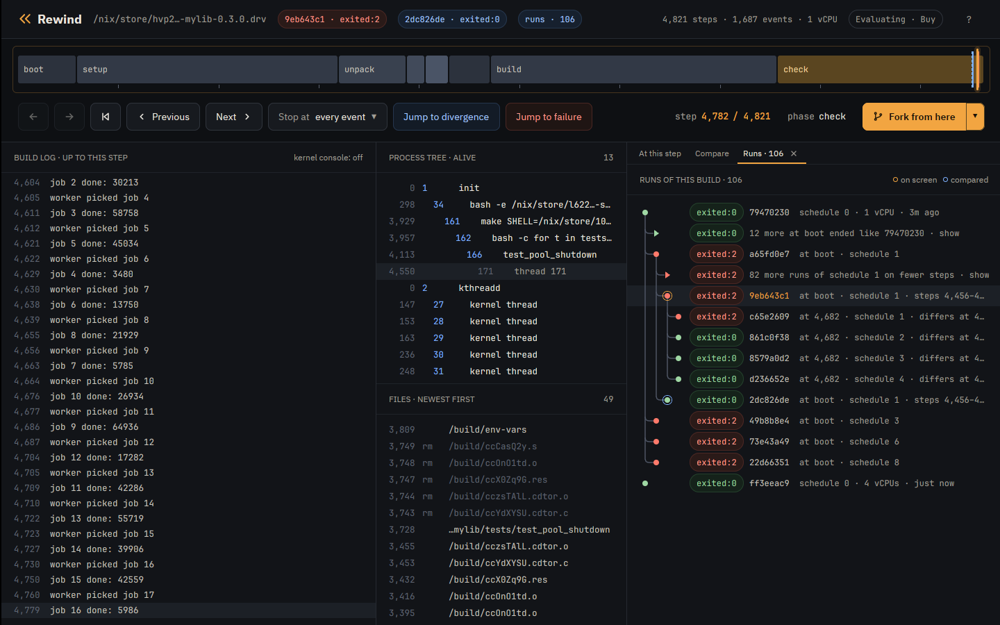

Fork from here forks the run at the playhead with the next schedule. Clicking
a run opens it compared with the run it hangs under; right-clicking offers
more.

## Find a run again

A command takes a run by its id or a prefix of it, by `@` for the newest run
and `@2`, `@3` and on for the ones before it, by name, or by directory.
`rewind ls` lists runs newest first, and filters them:

```console
$ rewind ls -n 3
d7613fabd9c4bb6d  exited:0          6735 steps  mylib-0.3.0 (fork of c2ca1ecd2243eff6 at 5005, schedule 4)
e683d3ea860e70bd  exited:2          5147 steps  mylib-0.3.0 (fork of c2ca1ecd2243eff6 at 5005, schedule 3)
d5fb1b2ea1be0a74  exited:0          6560 steps  mylib-0.3.0 (fork of c2ca1ecd2243eff6 at 5005, schedule 2)

$ rewind ls --forks-of c2ca1ecd --status failed
e683d3ea860e70bd  exited:2          5147 steps  mylib-0.3.0 (fork of c2ca1ecd2243eff6 at 5005, schedule 3)
db259d548c9a8e5f  exited:2          5164 steps  mylib-0.3.0 (fork of c2ca1ecd2243eff6 at 5005, schedule 1)
```

`--name` and `--since` (`30m`, `2h`, `7d` or a date) filter too.

`rewind open` starts the app on a run, at a step and beside another run.
`check` and `fork` print the command that opens what they made:

```console
$ rewind open c2ca1ecd 5105 --compare 516c10ee
```

## Rebuild a run exactly

A run's id is the hash of its inputs, which its `manifest.json` lists, so the
same command makes the same run on a machine with the same CPU vendor and
guest. `rewind show` prints that command with every input spelled out,
including the epoch, which defaults to the start of the day the run was made.
For a fork it prints its parents' commands first. `@`, the newest run, is the
schedule 4 fork:

```console
$ rewind show @
d7613fabd9c4bb6d  exited:0          6735 steps  mylib-0.3.0 (fork of c2ca1ecd2243eff6 at 5005, schedule 4)
...
rewind nix /nix/store/...-mylib-0.3.0.drv --epoch 1790985600 --schedule 3 --schedule-from 4821 --schedule-until 5081 --cpu v3 --clock branches --name mylib-0.3.0  # c2ca1ecd2243eff6
rewind fork c2ca1ecd2243eff6 5005 --schedule 4  # d7613fabd9c4bb6d
```

The failing run's command makes it again, with the same id:

```console
$ rewind show c2ca1ecd | tail -1 | sh
...
rewind: run c2ca1ecd2243eff6 exited:2 after 5145 steps, 0.203s virtual, 0.963s wall (poweroff)
```

## Compare any two runs

`rewind diff` compares every event of two runs, where `check` compares only
the failing program's:

```console
$ rewind diff 516c10ee c2ca1ecd
first difference at event 1733: step 5081 on the left, step 5103 on the right
  both        5063   166/173   write(1, "job 27 done: 47698\n")
  both        5065   166/173   write(1, "worker picked job 29\n")
  both        5080   166/174   write(1, "job 28 done: 31871\n")
  left        5081   166/174   write(1, "worker picked job 30\n")
  left        5088   166/173   write(1, "job 29 done: 509\n")
  left        5089   166/173   write(1, "worker picked job 31\n")
  left        5099   166/174   thread exit(test_pool_shutd) exited:0
  right       5103     0/0     console "[    0.202888] test_pool_shutd[174]: segfault at 108 ip 00005556d620d437 sp 00007feee6e68e10 error 6 in test_pool_shutdown[1437,5556d620d000+1000] likely on CPU 0 (core 0, socket 0)"
  right       5104     0/0     console "[    0.202893] Code: fa 48 8d 35 2a 0c 00 00 bf 02 00 00 00 b8 00 00 00 00 e8 ac fc ff ff 48 8b 05 b5 2b 00 00 48 8b 38 e8 8d fc ff ff 49 8b 46 58 <83> 80 08 01 00 00 01 e9 b5 fe ff ff 55 48 89 e5 41 54 53 be 78 00"
  right       5105   166/174   SIGSEGV code=1 addr=0x108
  right       5108   166/166   SIGSEGV code=0 addr=0x0
```

In the app, any run compared with another shows where they part, on the
timeline and in the divergence card:

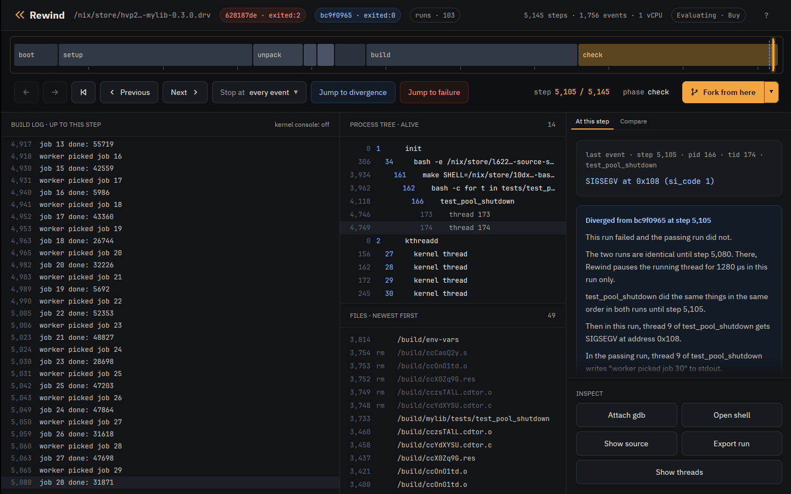

The card's Compare side by side link opens the Compare tab: the last events
both runs shared, then each run's next events side by side, with what differs
in amber. The x key swaps to the other run at the matching step, and x again
comes back:

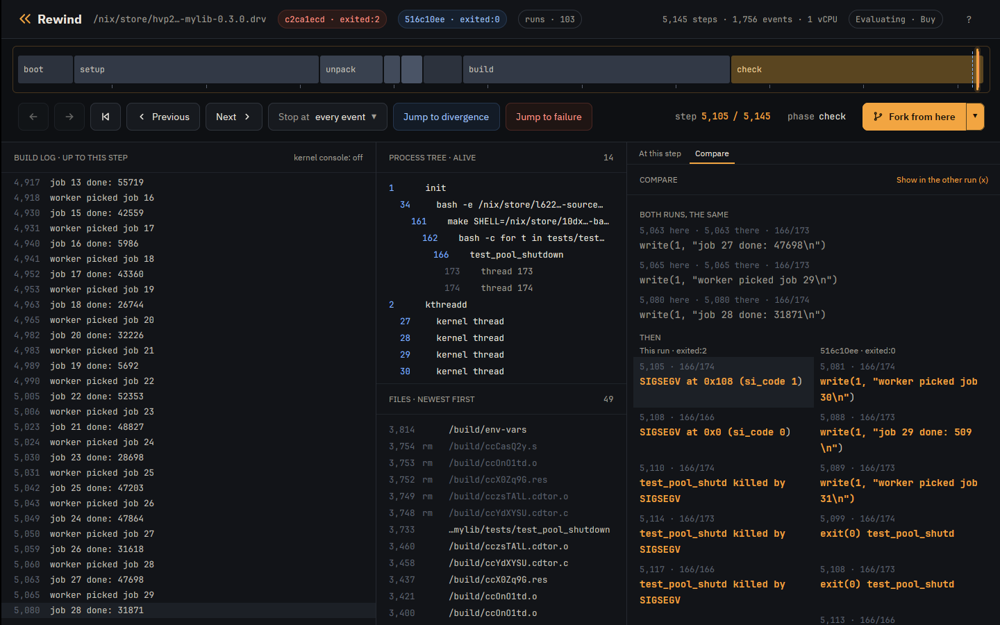

## Script it

`run`, `nix` and `fork` exit with the job's status, as a shell would report
it, so a shell loop can ask which schedules fail from a step:

```console
$ for s in 5 6 7 8; do rewind fork c2ca1ecd 5005 --schedule $s --quiet 2>/dev/null; echo "schedule $s: exit $?"; done
schedule 5: exit 0
schedule 6: exit 0
schedule 7: exit 0
schedule 8: exit 0
```

`check` exits 1 when a run fails a property, by default by ending
differently from schedule 0, and 0 when none does, `diff`
1 when the runs differ, `cat` 3 when the file did not exist at the step, and
`doctor` 1 when this machine cannot record runs. With `--json`, commands
print JSON for a program to read in place of their text: one object, or from
`ls` and `events` one a line. `check --json` lists each run it tried under
`schedules`, with the properties the run violated under `violations`.

```console
$ rewind ls --forks-of c2ca1ecd --status failed --json | jq -r .id
e683d3ea860e70bd
db259d548c9a8e5f

$ rewind diff 516c10ee c2ca1ecd --json | jq -c '.divergence | {left_step, right_step}'
{"left_step":5081,"right_step":5103}
```

## Judge runs by properties

By default `check` fails a run that ends differently from schedule 0.
`--property` replaces that test with others, such as `no-crash` or
`single-writer=GLOB`, and can be repeated. `rewind check --help` lists the
built-in properties, and the [properties tutorial](tutorial-properties.md)
explains each one.

A program that calls the [Rewind
SDK](https://github.com/fzakaria/rewindvm/tree/main/sdk) asserts from the
inside: `always` must hold every time it runs, and `sometimes` must hold in
at least one run. Check adds the `sdk` property when schedule 0 calls the
SDK, and the app marks each failed assertion in red above the track.

A property can also be a script. It gets the run in `$REWIND_RUN`, can read
it with `rewind log`, `rewind events --json` or `rewind cat`, and exits 0
when the run is correct or 1 with the reason on its first line. This one
checks that `bank`'s deposits add up:

```console
$ cat adds-up.sh
#!/bin/sh
# The deposits add up: bank prints its balance and what it expected.
line=$(rewind log "$REWIND_RUN" | grep "^balance ")
test "$line" = "balance 400, expected 400" && exit 0
echo "$line"
exit 1
```

```console
$ rewind check --epoch 1790985600 --property script=./adds-up.sh github:fzakaria/rewindvm#bank | grep -E 'decides it|failing run violates adds-up'
rewind: packing 62 store paths for bank-0.1.0
step 3258 decides it: a reschedule there makes the run violate adds-up, sdk
failing run violates adds-up: balance 380, expected 400
```

`--properties` reads properties from a file, one a line, so a repository
can keep them beside its tests. A script's path in the file is relative to
the file's directory:

```console
$ cat rewind.properties
# What a correct bank run is.
no-crash
script=adds-up.sh

$ rewind check --epoch 1790985600 --properties rewind.properties github:fzakaria/rewindvm#bank | grep 'decides it'
step 3258 decides it: a reschedule there makes the run violate adds-up, sdk
```

## Count the schedules that fail from a step

`rewind fork` tries one schedule from a step. `check --run` tries many, each a
fork at `--schedule-from`, with the run itself as schedule 0. `--no-narrow`
stops at the count. From the deciding step of the passing run:

```console
$ rewind check --run 516c10ee --schedule-from 5080 --schedules 16 --all --no-narrow
schedule   0: exited:0       6355 steps  a9d703ba8977  run 516c10eebf667023
schedule   1: exited:2       5151 steps    run 66a4458035eb7453
schedule   2: exited:0       6622 steps  a9d703ba8977  run 34be4df6cd2d5fa3
schedule   3: exited:2       5147 steps    run 8cdb67cbd9b05451
schedule   4: exited:0       6656 steps  a9d703ba8977  run 3358300b0b06ed58
schedule   5: exited:0       6630 steps  a9d703ba8977  run 52f1b8e2c5c96725
schedule   6: exited:0       6670 steps  a9d703ba8977  run a5edd8496ac64b2f
schedule   7: exited:0       6666 steps  a9d703ba8977  run c22fb92e33d8e73e
schedule   8: exited:2       5146 steps    run 22cfe676b7f6deb3
schedule   9: exited:0       6528 steps  a9d703ba8977  run a4790454fca0c2cf
schedule  10: exited:0       6613 steps  a9d703ba8977  run 60921b94d643330c
schedule  11: exited:0       6585 steps  a9d703ba8977  run ef63a333dae4e458
schedule  12: exited:2       5144 steps    run 05b576ea5b75d75b
schedule  13: exited:0       6662 steps  a9d703ba8977  run a119d86c9ef77739
schedule  14: exited:0       6663 steps  a9d703ba8977  run acca7909d5a77867
schedule  15: exited:0       6633 steps  a9d703ba8977  run d80914166b8f7f97
schedule  16: exited:0       6651 steps  a9d703ba8977  run 199a9c41c4dc92c5
4 of 16 perturbed schedules ended differently
```

4 of the 16 crash. Without `--no-narrow`, `check --run` narrows the first of
them to the step that decides it, as for a build.

In the app, the chevron beside Fork from here turns it into Check from here,
which runs the schedules from the playhead and fills a cell per schedule:
grey for ended as this run did, blue for differently. Pick a cell to compare
with or open its run:

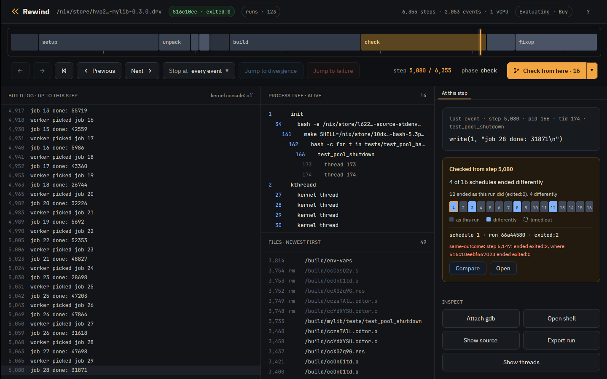

## Try other seeds from a step

A fork keeps its parent's randomness unless you reseed it. `rewind fork
--seed` reseeds the VM's randomness at the fork's step. `check --run
--seeds` tries the run's own seed and several others, each a fork of the
run reseeded at `--schedule-from`. `hash-order`'s test depends on the order
of a Rust `HashSet`, which Rust draws from that randomness:

```console
$ rewind nix -q --epoch 1790985600 --name hash-order github:fzakaria/rewindvm#hash-order
...
/nix/store/8fzgvvjf4iffwijx3njlhg40m0xxnlw4-hash-order-0.1.0 83f239c2e3135166  not in your store or 6 caches
```

```console
$ rewind check --run hash-order --seeds 8 --schedules 0 | grep -E 'decides it|passing:|failing:'
seed 1 decides it: unperturbed, seed 0 passes and seed 1 fails
passing: run 2fedde184b908b25, seed 0, schedule 0
failing: run 64f50ddd67b8feac, seed 1 from step 301, schedule 0
```

## Move around a long run

Builds of larger projects run to hundreds of thousands of steps. The app has
keys to jump to a step, step between events of one kind, bookmark, search and
zoom the timeline. The ? key lists them all:

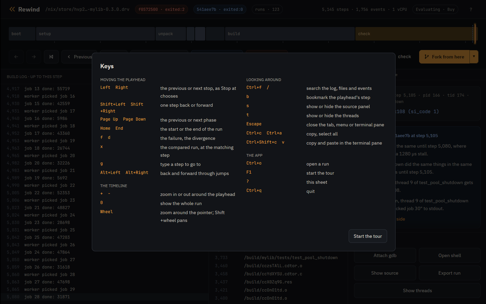

## Hand a failure to someone else

```console
$ rewind export c2ca1ecd --replayable -o crash.rwd
rewind: wrote crash.rwd (201.3 MB)

$ REWIND_HOME=elsewhere rewind import crash.rwd
c2ca1ecd2243eff6  exited:2          5145 steps  mylib-0.3.0

$ REWIND_HOME=elsewhere rewind replay c2ca1ecd
identical: 1756 events over 5145 steps
```

A replayable export carries the keyframes, the image and the VM's kernel, and
replays on any machine with the same CPU vendor. Without `--replayable` it is
the events alone, 18.0 KB: enough to read and to scrub in the app, whose
Export button writes the replayable kind. Both kinds carry the run's
bookmarks.

The other machine also needs the features of the run's CPU model. A run
without `--cpu` gets `v3`, whose features include ERMS, the fast `rep movsb`
flag. On a host that lacks only ERMS it gets `v3-compat` instead, the same CPU
with ERMS hidden, and rewind prints a line saying so. A `v3` run needs a host
with ERMS, and a `v3-compat` run replays on hosts with or without it. A replay
on a host without the model's features names what is missing and where the
run replays, and `rewind doctor` says which model a run gets on a machine.

## Which clock

```console
$ rewind pmu status
cpu: AMD Zen (family 25)
amd workaround (MSR 0xc0011020 bit 54): set by `rewind pmu enable` this boot
perf_event_paranoid: 2
self-test: 40046500 and 40046500 branches, exact at every exit
runs will use counter time
```

With counter time the VM's clock follows the work done inside it; with exit
time computation takes no virtual time. `--clock` picks one. [Counter
time](pmu.md) explains. `rewind doctor` checks the clock with KVM, gdb and
the rest of what rewind uses, and says what to do about each problem.

## Find where a run hung

A thread gives up the VM's one CPU only at a step, so a loop that makes no
system call keeps it, and the run hangs. `--timeout` stops a run after that
many seconds on your machine. When the guest had gone a second or more
without an exit, rewind says where it was stuck. A program that spins, built
static with its symbols:

```console
$ printf 'volatile unsigned long n;\nint main(void) { for (;;) n++; }\n' > spin.c
$ mkdir -p spin/bin
$ nix shell nixpkgs#pkgsStatic.stdenv.cc -c x86_64-unknown-linux-musl-cc -static -g -o spin/bin/spin spin.c
```

```console
$ rewind run --root spin --timeout 5 --name spin -- /bin/spin
rewind: run 94bb51fd74eaa565 timed-out after 309 steps, 0.002s virtual, 5.009s wall (timed out computing without exits for 4.1s, in user space in main+15 (spin.c:2), process 34 (spin))
```

A run that timed out while still making exits was slow rather than stuck, and
says so. `rewind check` gives each perturbed schedule ten times as long as
schedule 0 took, at least a minute, and reports a stuck schedule the same
way. Schedule 0 itself has no limit, since a long build is no reason to stop
it, so a test suite that hangs there holds up the whole check. Give such a
suite `rewind check --timeout`, which bounds every schedule, schedule 0
included. `--status timed-out` lists the runs that timed out:

```console
$ rewind ls --status timed-out
94bb51fd74eaa565  timed-out          309 steps  spin
```

## Keep the run directory tidy

Runs live under `~/.local/share/rewind`, or `REWIND_HOME`:

```console
$ REWIND_HOME=elsewhere rewind ls
d5fb1b2ea1be0a74  exited:0          6560 steps  mylib-0.3.0 (fork of c2ca1ecd2243eff6 at 5005, schedule 2)
db259d548c9a8e5f  exited:2          5164 steps  mylib-0.3.0 (fork of c2ca1ecd2243eff6 at 5005, schedule 1)
c2ca1ecd2243eff6  exited:2          5145 steps  mylib-0.3.0

$ REWIND_HOME=elsewhere rewind remove d5fb1b2e
removed d5fb1b2ea1be0a74
rewind: `rewind gc` removes the pages no run uses any more
```

`remove` takes a run with every run forked from it. To remove every fork and
keep the runs they came from, run
`rewind ls | awk '/fork of/ {print $1}' | xargs rewind remove`.
`prune --identical` removes forks that ran exactly as an older one did.

## What to read next

- [Design](design.md): how the machine is made deterministic, and its
  [limits](design.md#limits).
- The [case studies](case-studies/nix-gc-closure-sigpipe.md): these tools on
  bugs in real projects.
