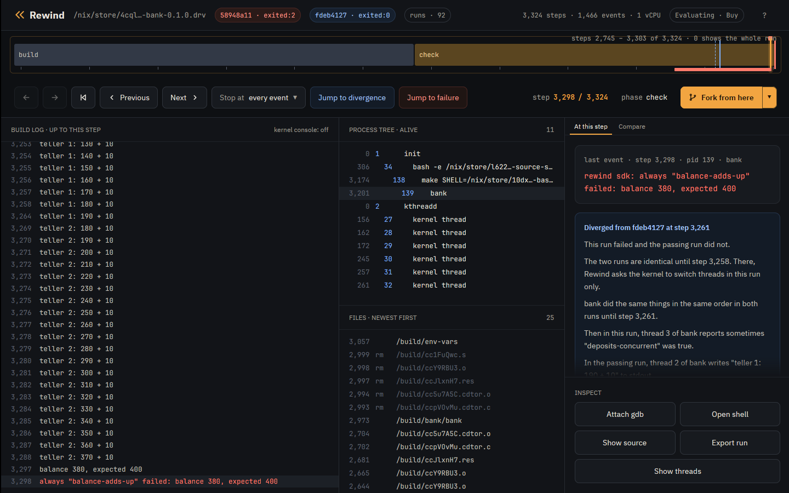
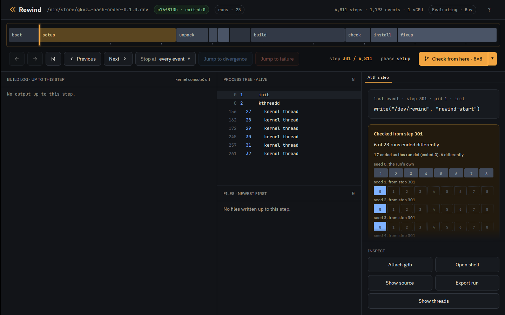

# Tutorial: property-based testing

By default `rewind check` judges a run by how it ends. It runs the job
under many thread schedules and calls a schedule failing when it ends
differently from schedule 0, the run with nothing perturbed: another exit
status, a signal, or an output with another hash. A test that exits 0 on
schedule 0 and 1 on schedule 5 is the bug the [Nix tutorial](tutorial-nix.md)
finds.

You can also state properties that every run must have, and check judges
each schedule by them. A property can be one of Rewind's built-in checks on
the files and processes a run touched, an assertion the program makes about
itself with the Rewind SDK, or a script of your own. Check can also vary the
program's randomness with seeds, as well as its schedule.

The examples are three small programs from
[examples](https://github.com/fzakaria/rewindvm/tree/main/examples):
`config-reload`, `bank` and `hash-order`. Install Rewind as the
[Nix tutorial](tutorial-nix.md) does.

## Catch a bug on the first run

`config-reload` rewrites its config file in place: it truncates the file,
then writes the two lines one at a time. Another process rereads the file
meanwhile. The program's own test fails only when a read lands between the
truncate and the last write, which few schedules do.

The `atomic-replace` property fails a run that truncates a file in place,
where it should write a new file and rename it over the old one. The
property looks at what the program did, not at how the run ended, so
schedule 0 already violates it and check finds the bug with no search:

```console
$ rewind check --epoch 1790985600 --schedules 8 --property 'atomic-replace=*.conf' github:fzakaria/rewindvm#config-reload
rewind: packing 62 store paths for config-reload-0.1.0
schedule   0: exited:0             4563 steps  f7b1c7741aba  run bf6b4edf2f924261  violates atomic-replace
  atomic-replace: step 3238: process 139 (config) truncated /build/config-reload/app.conf in place, which the run wrote at step 3233; a reader can see it empty or half written
...
schedule   8: exited:2             3778 steps    run 266053bff1e5df50  violates atomic-replace
every schedule violated a property, as schedule 0 did
open it at the step: rewind open bf6b4edf2f924261 3238
```

`atomic-replace` flags the unsafe write whether or not a reader saw the
half-written file. `no-read-while-written` flags the reader: it fails a run
in which a process opens the file for reading while another process has it
open for writing. Only some schedules do that, so check searches for one and
narrows it to the step that decides it:

```console
$ rewind check --epoch 1790985600 --property 'no-read-while-written=*.conf' github:fzakaria/rewindvm#config-reload | grep -E 'decides it|failing run'
schedule 1 violates no-read-while-written; finding the step that decides it
step 3274 decides it: a request to switch threads there makes the run violate no-read-while-written
failing run violates no-read-while-written: step 3285: process 140 (config) opened /build/config-reload/app.conf for reading while process 139 (config), which opened it for writing at step 3274, had not closed it
```

`--property` replaces the default, and you can repeat it to judge runs by
several properties. Rewind includes these:

| Property                     | A run violates it when                                                 |
| ---------------------------- | ---------------------------------------------------------------------- |
| `same-outcome`               | it ends differently from schedule 0; the default                       |
| `exit-zero`                  | the job does not exit 0 with every output made                         |
| `no-crash`                   | a process dies of a signal such as SIGSEGV, even if a retry hid it     |
| `no-orphans`                 | a process the job started is still running when the job exits          |
| `single-writer=GLOB`         | two processes have a matching file open for writing at once            |
| `atomic-replace=GLOB`        | a matching file the run wrote is truncated in place                    |
| `no-read-while-written=GLOB` | a matching file is opened for reading while another process writes it  |
| `writes-within=DIR:DIR`      | the job writes outside these directories                               |
| `sdk`                        | an assertion made with the Rewind SDK fails                            |
| `junit=GLOB`                 | a test that passed on schedule 0 fails, by the job's JUnit XML reports |
| `script=PATH`                | a program of yours exits 1                                             |

`rewind check --help` describes each in full.

## Assert from inside the program

`bank` has two threads deposit into one balance without a lock, so one
deposit can overwrite another. It includes `rewind.h`, the C header of the
Rewind SDK, and makes two assertions:

```c
/* Another teller is mid-deposit: the case a lock around the read and
 * store has to handle, and the only way to lose a deposit without one. */
int others = atomic_fetch_add(&depositing, 1);
REWIND_SOMETIMES(others > 0, "deposits-concurrent");
...
REWIND_ALWAYS(balance == expected, "balance-adds-up", "balance %ld, expected %ld", balance,
	      expected);
```

`REWIND_ALWAYS` must be true every time the program reaches it. A run where
it is false violates the `sdk` property, and check prints the message.

`REWIND_SOMETIMES` tests the search, not the program: its condition must be
true in at least one of the runs check tries. It never fails a run. Here it
asks whether any run had both tellers mid-deposit at once.

Under schedule 0 alone, `bank` passes. That is one run, one teller always
finished its deposit before the other started, and check reports the
`sometimes` that never came true:

```console
$ rewind check --epoch 1790985600 --schedules 0 github:fzakaria/rewindvm#bank
...
schedule   0: exited:0             4556 steps  2ffd6b62eb30  run fdeb41272510870a  holds
never true in any run: sometimes "deposits-concurrent"
every property held under the one schedule tried
```

With its default 64 schedules, check puts both tellers mid-deposit and finds
a run that loses a deposit:

```console
$ rewind check --epoch 1790985600 github:fzakaria/rewindvm#bank | grep -E 'decides it|passing:|failing:|failing run violates sdk|^true in'
true in 15 of 17 runs that checked it: sometimes "deposits-concurrent"
schedule 1 violates same-outcome, sdk; finding the step that decides it
step 3258 decides it: a request to switch threads there makes the run violate same-outcome, sdk
passing: run fdeb41272510870a, schedule 0
failing: run 58948a11681339af, schedule 1 over steps 3258..3259
failing run violates sdk: step 3298: always "balance-adds-up" failed: balance 380, expected 400
```

Outside Rewind the SDK's calls do nothing, so they can stay in the program.
The [SDK](https://github.com/fzakaria/rewindvm/tree/main/sdk) has a small
library for C, Rust, Go, Python, Java and shell, and a pytest plugin and a
JUnit 5 extension that mark each test's result.

## Check the fix

Clone the repository to edit `bank`:

```console
$ git clone https://github.com/fzakaria/rewindvm
$ cd rewindvm
```

In `examples/bank/bank.c`, hold a mutex from each deposit's read of the
balance to its store:

```diff
@@ -25,6 +25,9 @@
 /* How many tellers are inside deposit. */
 static atomic_int depositing;

+/* Held from a deposit's read of the balance to its store. */
+static pthread_mutex_t lock = PTHREAD_MUTEX_INITIALIZER;
+
 /* The race: the balance read here is stale by the time it is stored. */
 static void deposit(int teller, long amount)
 {
@@ -33,6 +36,7 @@
 	int others = atomic_fetch_add(&depositing, 1);
 	REWIND_SOMETIMES(others > 0, "deposits-concurrent");

+	pthread_mutex_lock(&lock);
 	long seen = balance;
 	char line[64];
 	int n = snprintf(line, sizeof line, "teller %d: %ld + %ld\n", teller, seen, amount);
@@ -40,6 +44,7 @@
 	if (write(1, line, n) == n) {
 		balance = seen + amount;
 	}
+	pthread_mutex_unlock(&lock);
 	atomic_fetch_sub(&depositing, 1);
 }

```

```console
$ rewind check --epoch 1790985600 .#bank | grep -E '^true in|^every property'
rewind: packing 62 store paths for bank-0.1.0
true in 62 of 65 runs that checked it: sometimes "deposits-concurrent"
every property held under all 65 schedules
```

The balance adds up in all 65 runs, and in 62 of them both
tellers were mid-deposit at once, so the search made them contend for the
lock and the lock held. Without the `sometimes`, a clean search could also
mean the tellers never overlapped.

The `sometimes` marks the risky state rather than the bug. One true only
when a deposit is lost would never come true once the lock is in, and
check would report it as never reached on a correct program.

## Vary the randomness

`hash-order` tests a function that collects tags in a Rust `HashSet` and
expects them back in a fixed order. A `HashSet`'s order depends on a random
key that Rust draws from the system when it makes the set. In the VM, the
system's randomness comes from the run's `--seed`, so the key is the same on
every schedule, every schedule passes, and no number of schedules finds the
bug. `--seeds 8` runs the job under 8 seeds:

```console
$ rewind check --epoch 1790985600 --seeds 8 --schedules 0 github:fzakaria/rewindvm#hash-order | grep -E '^seed|decides it|passing:|failing:'
rewind: packing 67 store paths for hash-order-0.1.0
seed  0 schedule   0: exited:0             4811 steps  83f239c2e313  run c76f813b3fb4f94d
seed  1 schedule   0: exited:2             3557 steps    run 6fa30ed1eb8b0f1b
seed 1 decides it: under schedule 0, seed 0 passes and seed 1 fails
passing: run c76f813b3fb4f94d, seed 0, schedule 0
failing: run 6fa30ed1eb8b0f1b, seed 1, schedule 0
```

Seed 1 puts the tags in the other order and the test fails.
With `--schedules` above 0, check also perturbs the schedule under each
seed, so one search varies the randomness and the timing together.

## In the desktop app

Open the failing `bank` run beside the passing one, at the assertion:

```console
$ rewind open 58948a11 3298 --compare fdeb4127
```



The red mark above the track is the failed assertion; hover over it to see
its message. The event card names it too, and Jump to failure goes to it.
`bank` also marks its test's start and result with the SDK, as the pytest
and JUnit plugins do for each test. The strip under the track has a span per
test: green if it passed, red if it failed.

The chevron beside Fork from here also offers Check from here with 8 seeds
of 8 schedules. It tries 8 schedules under the run's own seed, and 8 under
each of 7 other seeds, as forks reseeded at the playhead. At the start of
`hash-order`'s passing run it shows a row of cells per seed, blue where the
test failed:



## What to read next

- [The advanced tutorial](tutorial-advanced.md): a property as a script, a
  file of properties, and seeds from a step of a recorded run.
- [The SDK](https://github.com/fzakaria/rewindvm/tree/main/sdk): what each
  call is for, in every language.
- [Design](design.md#exploring-interleavings): how the search and narrowing
  work.
