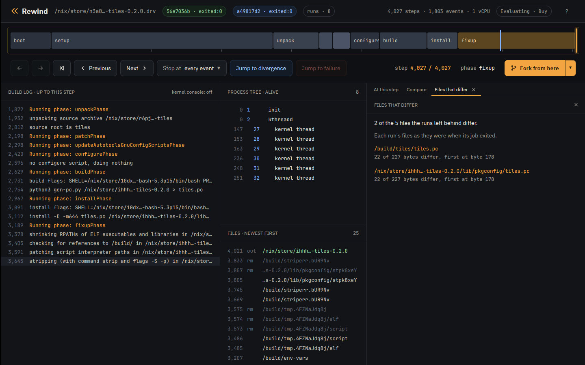
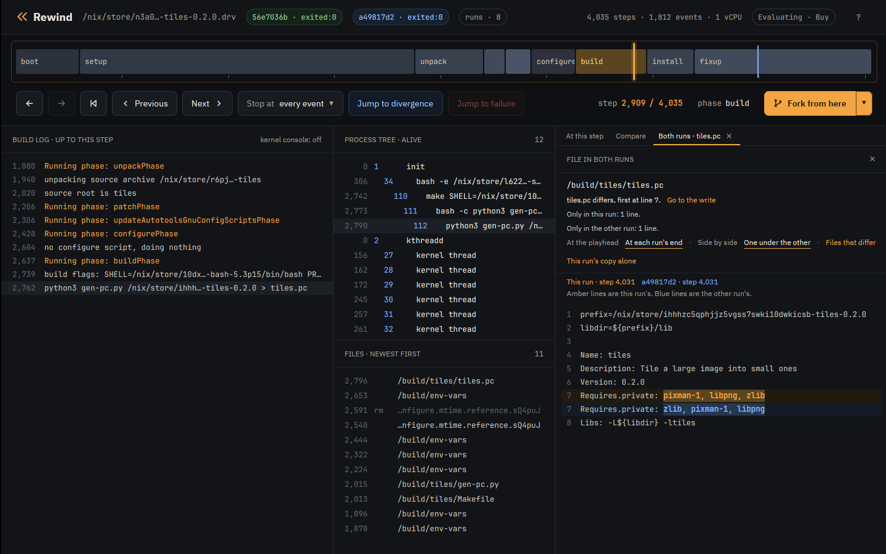

# Tutorial: reproducible builds

A build is reproducible when the same inputs give the same bytes, so anyone
can rebuild a package and check that it matches the one they were given.
Rewind VM fixes every input of a build, down to its random numbers, the
order its threads run in and the order its directories list in, so one
build makes the same run every time. Change one of those inputs and build
again: if the output changes, that input changed it, and both runs are kept
to replay and compare.

The examples are `tiles` and `plugins` from
[examples](https://github.com/fzakaria/rewindvm/tree/main/examples), two
small builds that each write one text file. Install Rewind as the
[Nix tutorial](tutorial-nix.md) does.

## Build it under eight seeds

`tiles` writes the pkg-config file of a small library with a Python script.
The script collects the packages the library links against into a set, and
Python iterates a set of strings in an order drawn from its hash seed.
nixpkgs sets `PYTHONHASHSEED=0` in any build that has Python as an input, so
`tiles` unsets it, to stand for a build that runs Python some other way.

A run's seed decides every random number the build draws, Python's hash seed
among them. `check` builds `tiles` under eight seeds, each with the default
schedule only:

```console
$ rewind check --epoch 1790985600 --seeds 8 --schedules 0 --all --no-narrow github:fzakaria/rewindvm#tiles
rewind: packing 75 store paths for tiles-0.2.0
rewind: 8 random seeds, each run under schedule 0 and 0 other schedules: 8 runs
seed  0 schedule   0: exited:0       4035 steps  d20b5efd388d  run 8d29a01cc44264b4
seed  1 schedule   0: exited:0       4035 steps  b4501793e383  run c4bd9260b7719942
seed  2 schedule   0: exited:0       4035 steps  0cd5db6c5c2c  run a5448b8d2ca19c18
seed  3 schedule   0: exited:0       4035 steps  24f18f09c329  run b03811e63cc68d97
seed  4 schedule   0: exited:0       4035 steps  b4501793e383  run ed28383bea49e84f
seed  5 schedule   0: exited:0       4035 steps  5e1f0a457cbe  run f5e8d2ac2c4b7782
seed  6 schedule   0: exited:0       4035 steps  d20b5efd388d  run af24df10ae7ac1e8
seed  7 schedule   0: exited:0       4035 steps  b4501793e383  run b5268e20063c5a9e
6 of 7 other runs ended differently
```

The column before each run id is the start of the output's hash. Eight
builds made 5 different outputs, so `tiles` is not
reproducible.

## What differs

Compare seed 0's run with seed 1's:

```console
$ rewind diff --outputs 8d29a01c c4bd9260
2 of the 5 files the runs left behind differ:
  /build/tiles/tiles.pc: 22 of 227 bytes differ, first at byte 178
  /nix/store/...-tiles-0.2.0/lib/pkgconfig/tiles.pc: 22 of 227 bytes differ, first at byte 178

$ rewind diff --file /build/tiles/tiles.pc 8d29a01c c4bd9260
tiles.pc differs, first at line 7.
Only in the left run: 1 line.
Only in the right run: 1 line.

Lines marked - are only in the left run. Lines marked + are only in the right run.
  Name: tiles
  Description: Tile a large image into small ones
  Version: 0.2.0
- Requires.private: pixman-1, libpng, zlib
+ Requires.private: zlib, pixman-1, libpng
  Libs: -L${libdir} -ltiles
```

`--outputs` lists the files the runs left behind whose bytes differ: the
installed `tiles.pc`, and the copy in the build directory it was installed
from. `--file` shows the lines: the same three packages in another order.

## Who wrote it

`rewind blame` takes two runs and a file, and names the program that wrote
the first byte that differs:

```console
$ rewind blame 8d29a01c c4bd9260 /nix/store/ihhhzc5qphjjz5vgss7swki10dwkicsb-tiles-0.2.0/lib/pkgconfig/tiles.pc
tiles.pc differs at byte 178. python3 (pid 112) wrote that byte at step 2,909 in run 8d29a01c and at step 2,909 in run c4bd9260.

22 of 227 bytes differ. The bytes from byte 178:
  8d29a01c  70 69 78 6d 61 6e 2d 31 2c 20 6c 69 62 70 6e 67  |pixman-1, libpng|
  c4bd9260  7a 6c 69 62 2c 20 70 69 78 6d 61 6e 2d 31 2c 20  |zlib, pixman-1, |

Who wrote the file in run 8d29a01c, from the last writer back:
  install (pid 122) copied it from /build/tiles/tiles.pc, starting at step 3,157. Its source already differs, so the copy did not cause the difference.
  bash (pid 112) wrote /build/tiles/tiles.pc, starting at step 2,796. It is the first writer, and the file already differs when it is done.
Run c4bd9260 made the file the same way, with the same programs.

In both runs, one write of 227 bytes, from byte 0, set byte 178.

python3 ran with the same command line in both runs, so the difference comes from something it read or from randomness.

What python3 read:
  1 file that the build made, all the same in both runs: /build/tiles/gen-pc.py.
  31 other files that the build did not make, such as programs and libraries.

Likely cause: something inside python3 (pid 112), such as randomness or the order its threads ran in. Its command line and the files the build made that it read are the same in both runs.
```

The first line is the answer: python3, pid 112, wrote that byte at
step 2,909. The lines after it show how blame got there. `install`
only copied a file that already differed. Before that, pid 112 opened
`/build/tiles/tiles.pc` while it was still `bash`, for the `>` redirect,
then became python3. python3 had the same command line and read the same
`gen-pc.py` in both runs, so the cause is inside it, and the seed is the one
input that changed.

Blame works from records the guest kernel keeps in every run: each write to
a file, and each file a program opens. It finds the write that set the byte
without replaying either run.

## In the app

Open the two runs side by side:

```console
$ rewind open 8d29a01c --compare c4bd9260
```

The Compare tab's Files that differ link lists what `diff --outputs` does:



A click on a file opens it from both runs. One under the other puts each
run's copy of a changed line together, this run's in amber and the other's
in blue. Go to the write moves the playhead to the step whose write set the
first byte that differs. For `/build/tiles/tiles.pc` that is step
2,909, with `python3 gen-pc.py` in the process tree:



## Fix it

Clone the repository to edit `tiles`:

```console
$ git clone https://github.com/fzakaria/rewindvm
$ cd rewindvm
```

In `examples/tiles/gen-pc.py`, sort the packages before writing them:

```diff
@@ -27,5 +27,5 @@
 print("Name: tiles")
 print("Description: Tile a large image into small ones")
 print(f"Version: {VERSION}")
-print(f"Requires.private: {', '.join(requires)}")
+print(f"Requires.private: {', '.join(sorted(requires))}")
 print("Libs: -L${libdir} -ltiles")
```

```console
$ rewind check --epoch 1790985600 --seeds 8 --schedules 0 --all --no-narrow .#tiles
...
0 of 7 other runs ended differently
same result under all 8 runs
```

Every seed now builds the same `tiles.pc`.

## Directory order

`plugins` writes an index of the plugins it ships, in the order
`os.listdir` returns them. Under eight seeds it reproduces:

```console
$ rewind check --epoch 1790985600 --seeds 8 --schedules 0 --all --no-narrow .#plugins
...
0 of 7 other runs ended differently
same result under all 8 runs
```

A directory lists in the order its filesystem keeps it. In the VM that order
is the same in every run: `/build` lists its newest file first. On a real
machine, ext4 lists a directory by a hash of each name, keyed by a seed
chosen when the disk was formatted, so two machines can list one directory
in two orders. The guest kernel does the same when its command line has
`rewind.dirents=N`: every directory lists in an order keyed by N. Build
under two keys:

```console
$ rewind nix --epoch 1790985600 --quiet --kernel-args rewind.dirents=1 .#plugins
rewind: run e4c221b26df20a9c exited:0 after 3885 steps, 0.097s virtual, 1.168s wall (poweroff)
/nix/store/b729hjnswi2l739nvpxzwmx4laf5ynlj-plugins-0.1.0 3d555b5412961f82  differs from your store
...

$ rewind nix --epoch 1790985600 --quiet --kernel-args rewind.dirents=2 .#plugins
rewind: run 593a9430de55e469 exited:0 after 3885 steps, 0.097s virtual, 1.165s wall (poweroff)
/nix/store/b729hjnswi2l739nvpxzwmx4laf5ynlj-plugins-0.1.0 925dde4ef23a27e2  differs from your store
...
```

The hash after each store path is the output's, and the two keys give two
outputs. The index is the file that changed:

```console
$ rewind diff --file /build/plugins/plugins.txt e4c221b2 593a9430
plugins.txt differs, first at line 3.
Only in the left run: 2 lines.
Only in the right run: 2 lines.

Lines marked - are only in the left run. Lines marked + are only in the right run.
  # The plugins this package ships, one a line.
  sharpen
+ resize
  crop
- blur
  rotate
- resize
+ blur
```

Under each key the index names the same five plugins in another order.

The key is one of the run's inputs, so each order replays. `check` does not
vary the key yet, and there is no `--dirents` option: give it with
`--kernel-args`.

In `examples/plugins/gen-index.py`, sort the names:

```diff
@@ -12,7 +12,7 @@

 directory = sys.argv[1]
 print("# The plugins this package ships, one a line.")
-for name in os.listdir(directory):
+for name in sorted(os.listdir(directory)):
     # Only the plugins' own files are plugins.
     if not name.endswith(SUFFIX):
         continue
```

```console
$ rewind nix --epoch 1790985600 --quiet --kernel-args rewind.dirents=1 .#plugins
...
rewind: run baa0f5b19a200665 exited:0 after 3885 steps, 0.097s virtual, 1.136s wall (poweroff)
/nix/store/qszqipypi46g5602vksnh8l6i9vqs2x5-plugins-0.1.0 164f7a685a087fd4  not in your store or 6 caches

$ rewind nix --epoch 1790985600 --quiet --kernel-args rewind.dirents=2 .#plugins
rewind: run 66cd95f7f45800ae exited:0 after 3885 steps, 0.097s virtual, 1.140s wall (poweroff)
/nix/store/qszqipypi46g5602vksnh8l6i9vqs2x5-plugins-0.1.0 164f7a685a087fd4  not in your store or 6 caches
```

Both keys now build the same output, `164f7a685a087fd4`.

## What to read next

Real packages do this too: neatvnc 0.7.1's pkg-config file, which meson
writes, differs between seeds, and setuptools 80.9.0 in nixpkgs builds a
wheel with another version under another directory order.

- [Directory order](design.md#directory-order) in the design notes: how
  the `rewind.dirents` key works.
- [Read and write records](design.md#read-and-write-records) in the
  design notes: what blame reads.
- [The properties tutorial](tutorial-properties.md): seeds in tests.
